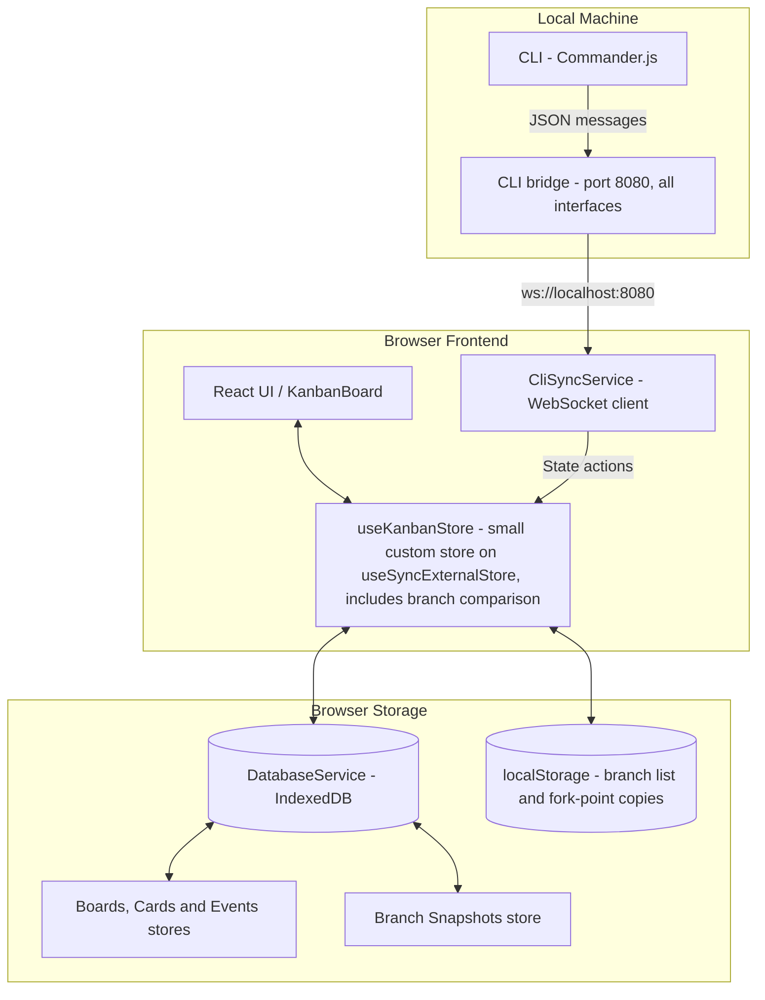

# KanbanLight

A Kanban board in the browser that borrows a few ideas from Git: create branches of a board, switch between them, and compare the current branch with another one. Board data is stored in your browser; there is no backend.

Version 0.0.1, an early build. Live demo: https://kanbanlight.vercel.app

An optional Node.js CLI can send commands to an open board over a local WebSocket bridge. It needs the local setup below and is meant for the web app running locally.

---

## Features

- **Branches:** create a branch of the board and switch between branches.
- **Per-branch snapshots:** each branch keeps its own snapshot of cards, columns and events, which is loaded when you switch to it.
- **Compare:** compare the current branch with another branch. Cards are marked as:
  - **Added** (green ring and tint): on the current branch, not in the other branch's last saved state.
  - **Modified** (amber ring and tint): on both, with different content.
  - **Deleted** (red dashed ring, shown faded in its original column): only in the other branch's last saved state.

  The comparison uses the other branch's last saved state, which is saved when that branch was created or last switched away from. It does not update while it is open, and it stays on when you switch branches, so turn it off before switching. The labels describe differences relative to the current branch, not which branch made the change: a card deleted on the other branch shows as Added here.
- **Markdown card descriptions**, rendered with `react-markdown` and `remark-gfm`.
- **Command palette**, opened with `Ctrl+K` (`Cmd+K` on macOS).
- **Light and dark mode.** The board follows the system setting until you use the toggle.
- **Local storage:** board data is stored in the browser's IndexedDB. The branch list, including a copy of the board from when each branch was created, is stored in `localStorage`. Your board is stored only in this browser; KanbanLight has no server and collects nothing (the host keeps standard request logs). Clearing this site's data deletes everything. Images linked in card descriptions are loaded from the sites that host them. While the CLI bridge runs, it sends card text to every program connected to it.
- **CLI bridge commands:** `serve`, `add`, `branch`, `checkout` / `switch`, `compare` / `diff` and `exit-diff`. See [cli/README.md](cli/README.md).

---

## Architecture



---

## Tech stack

- **Core:** React 18, TypeScript, Vite
- **State management:** a small custom store on React's `useSyncExternalStore`
- **Styling:** Tailwind CSS, Lucide React icons
- **Local database:** IndexedDB, through the `idb` wrapper
- **CLI:** Node.js, Commander.js, WebSocket (`ws`)

---

## Setup

Requires Node.js and npm. Developed with Node.js 22.

### Terminal 1: web app

```bash
git clone https://github.com/vardaanbazaz/kanbanlight.git
cd kanbanlight
npm install
npm run dev
```

Open the URL that Vite prints.

To make a production build instead:

```bash
npm run build
```

### Terminal 2: CLI bridge (optional)

Read the security note under "Known issues" first. The CLI is meant for the web app running locally: the hosted demo also tries to reach a bridge on `localhost:8080`, and browsers that check local-network access, such as Chrome, block that unless you allow it.

Then, from the `kanbanlight` directory:

```bash
cd cli
npm install
npx tsx src/index.ts serve
```

Leave it running.

### Terminal 3: CLI commands

From the `kanbanlight/cli` directory, with the bridge running and the web app open in a browser:

```bash
npx tsx src/index.ts --help
npx tsx src/index.ts add "Write release notes" -p high -c backlog
# after creating a branch and switching to it in the web app
npx tsx src/index.ts compare main
npx tsx src/index.ts exit-diff
```

The CLI's help text and messages refer to it as `kb`. In this setup, `kb <command>` means `npx tsx src/index.ts <command>` run from `cli/`.

---

## Known issues

1. CLI branch commands: only `main` works with `checkout`/`switch` and `compare`, and `branch -b` must not be used; other names create a broken branch, and after a reload the board can save that branch's cards as main's. Create and switch branches in the web app.
2. Branching stops on large boards: the branch list can outgrow the browser's localStorage limit; after that no new branch can be created, and branches cannot be deleted yet.
3. A malformed command sent through the bridge can leave the page blank on every load; recovery currently means clearing the site's data, which deletes the board.
4. Two tabs share one working copy: edits in one tab can land on another tab's branch, and every CLI command is applied once per open tab.
5. The bridge has no authentication, listens on all network interfaces and sends card text to every program connected to it. Run `serve` only on a trusted network and stop it when not in use.
6. The first-visit guided tour lags (close it with Esc or ×); the layout is desktop-only; export saves only the current branch's event log and there is no import, so browser storage is the only copy of a board.

---

## Roadmap

Planned, in no fixed order:

- Reliable branch commands from the CLI, and a bridge that only accepts paired clients.
- A redesigned interface, with a sample board on first visit.
- Drag-and-drop and card ordering.
- Merging branches, and deleting and renaming branches.
- Full export and import of a board.

## Parked prototypes

Earlier prototypes of branch merging, WASM plugins, real-time collaboration and a standalone CLI mode were removed in 0.0.1 because they did not work end to end (see CHANGELOG). Their code is preserved under the git tag `pre-audit-2026-09`.

---

## License

MIT License. Copyright (c) 2026 Vardaan Bajaj. See [LICENSE](LICENSE) for details.
