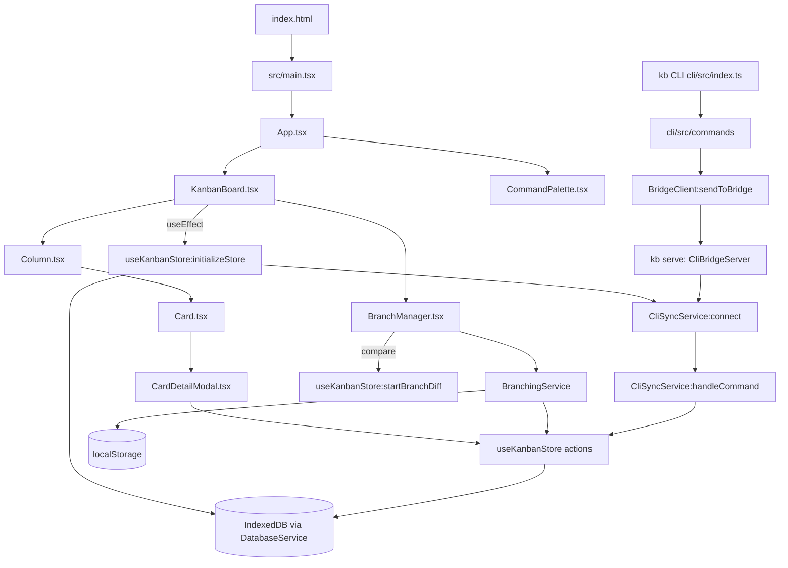

# Execution flow

How execution moves through KanbanLight 0.0.1. This describes the current code; it will be replaced when the data layer is rebuilt. There are two programs. One is the browser app in `src/`. The other is the optional `kb` CLI in `cli/`, which talks to the app over a local WebSocket bridge.

## Entry points

| Entry | Started by | File |
|---|---|---|
| Browser app | `npm run dev` / `npm run build` (Vite), loads `index.html` | `index.html`, then `src/main.tsx` |
| CLI | `npx tsx src/index.ts <command>` from `cli/` (written `kb <command>` below; `kb` is not installed by any step) | `cli/src/index.ts` |
| CLI bridge server | `kb serve` (alias `kb start`), default port 8080 | `cli/src/server.ts:startCliServer` |

The app has no routes. It is a single page. There are no background jobs except the bridge reconnect timer (below).

## Browser app: startup order

1. `index.html` loads `/src/main.tsx`.
2. Module evaluation creates singletons before React renders:
   - `src/services/BranchingService.ts:branchingService`. The constructor runs `loadBranches()`, which reads `localStorage['kanban-branches']`. If that key is missing, it creates and saves the `main` branch.
   - `src/services/DatabaseService.ts:databaseService` (no I/O yet).
   - `src/services/CliSyncService.ts:cliSyncService` (port 8080, not connected yet).
   - `src/store/useKanbanStore.ts:useKanbanStore`, a hand-rolled Zustand-style store on `useSyncExternalStore`.
3. `src/main.tsx` renders `<App/>` inside `StrictMode`. In dev mode, StrictMode runs effects twice.
4. `src/App.tsx:App` renders `ThemeProvider`, then `KanbanBoard` and `CommandPalette`.
5. `src/components/KanbanBoard.tsx:KanbanBoard` runs `useEffect` → `useKanbanStore:initializeStore`:
   - `DatabaseService:initialize` opens IndexedDB `kanban-light` v2 and creates stores in `upgrade`.
   - `DatabaseService:getAllBoards`. If there is none, it creates `default-board` (`saveBoard`).
   - `DatabaseService:getCardsByBoard` and `getEventsByBoard`.
   - It builds the local user (`name: 'You'`).
   - `CliSyncService:connect` opens `ws://localhost:8080`. On close it reconnects every 3 s (`scheduleReconnect`).
   - `activeBranchId` comes from `BranchingService:getCurrentBranch`.
   - If the branch has no snapshot (`DatabaseService:getLatestSnapshotByBranch`), it calls `useKanbanStore:createSnapshot`.
6. `KanbanBoard` opens `GuidedTour` on first visit, when `localStorage['kanbanlight-tour-completed']` is not `'true'`.

## Browser app: main user actions

| Action | UI entry | Call chain |
|---|---|---|
| Add card (column) | `Column.tsx` add button | `useKanbanStore:createCard` → `DatabaseService:saveCard` → `useKanbanStore:dispatchBoardEvent` → `DatabaseService:saveEvent` |
| Add card (modal) | sidebar Quick Actions "New card" (or palette) → `SmartCardCreator.tsx` | `KanbanBoard:handleCreateCard` → `useKanbanStore:createCard` |
| Open / expand card | `Card.tsx:handleCardClick` (double-click opens, single click expands) | opens `CardDetailModal.tsx` |
| Edit / move / delete | `CardDetailModal.tsx` | `useKanbanStore:updateCard` / `deleteCard` → `DatabaseService:saveCard` / `deleteCard` → `dispatchBoardEvent` |
| Open Branch Manager | header button, sidebar "Manage Branches", or palette | `useKanbanStore:setShowBranchManager(true)` → `KanbanBoard` renders `BranchManager.tsx` |
| Create branch | `BranchManager.tsx:handleCreateBranch` | `BranchingService:createBranch` → `useKanbanStore:createSnapshot` → `useKanbanStore:switchBranch` |
| Switch branch | `BranchManager.tsx` switch button | `BranchingService:switchBranch` → `useKanbanStore:switchBranch` → `createSnapshot` (current) → `DatabaseService:getLatestSnapshotByBranch` (target) → `DatabaseService:syncActiveBoardCardsAndEvents` → `BranchingService:setActiveBranchId` |
| Compare | `BranchManager.tsx` compare button | `useKanbanStore:startBranchDiff`, which diffs the in-memory cards against the target's latest snapshot. `Column.tsx` reads `branchDiff` and renders `Card` with `diffStatus` |
| Exit compare | banner button in `KanbanBoard.tsx` | `useKanbanStore:exitDiffMode` |
| Export | header Database button in `KanbanBoard.tsx` | inline handler serializes the store's `events` array only (not cards, branches or snapshots) → Blob download `kanban-export-<ts>.json`. `DatabaseService:exportData` exists but nothing calls it |
| Command palette | Ctrl/Cmd+K (`CommandPalette.tsx`) | `setShowSmartCardCreator` / `setShowBranchManager` / other actions |
| Theme | header toggle | `ThemeProvider.tsx:toggleTheme` → `localStorage` |

Storage split: branches and the active branch id live in `localStorage` (`BranchingService`). Cards, events, boards and per-branch snapshots live in IndexedDB (`DatabaseService`).

## CLI flow

1. `cli/src/index.ts` parses argv with `commander`.
2. `kb serve` → `cli/src/server.ts:startCliServer` → `CliBridgeServer:start`. This is a `ws` server that broadcasts every message it receives to all connected clients.
3. Every other command (`checkout`/`switch`, `add`, `branch [-b]`, `compare`/`diff`, `exit-diff`) → `cli/src/commands/index.ts:<command>` → `cli/src/services/BridgeClient.ts:sendToBridge`. That opens a socket, sends one JSON message and closes. If the bridge is down it returns `false` after a 1.2 s timeout, and the command sets `process.exitCode = 1`.
4. The bridge broadcasts to the browser → `src/services/CliSyncService.ts:handleCommand`:
   - `SWITCH_BRANCH` → `useKanbanStore:switchBranch`
   - `CREATE_BRANCH` → `BranchingService:createBranch` (then `switchBranch` if `checkout`)
   - `COMPARE_BRANCH` → `useKanbanStore:startBranchDiff`
   - `EXIT_DIFF` → `useKanbanStore:exitDiffMode`
   - `CREATE_CARD` → `useKanbanStore:createCard`

`SWITCH_BRANCH` from the CLI calls the store directly and skips `BranchingService:switchBranch`, so a branch name that is not a known branch id is not rejected. This is the path behind the CLI branch known issue in the README.

