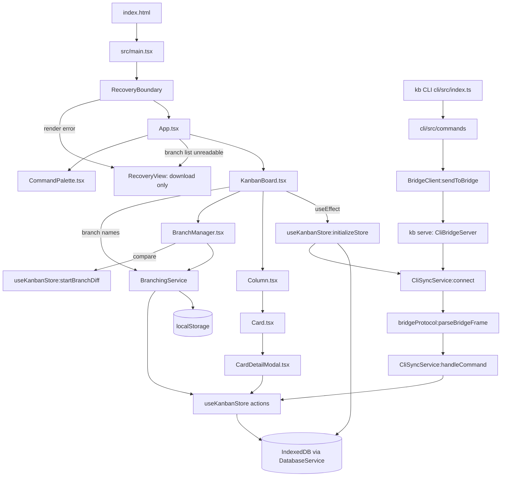
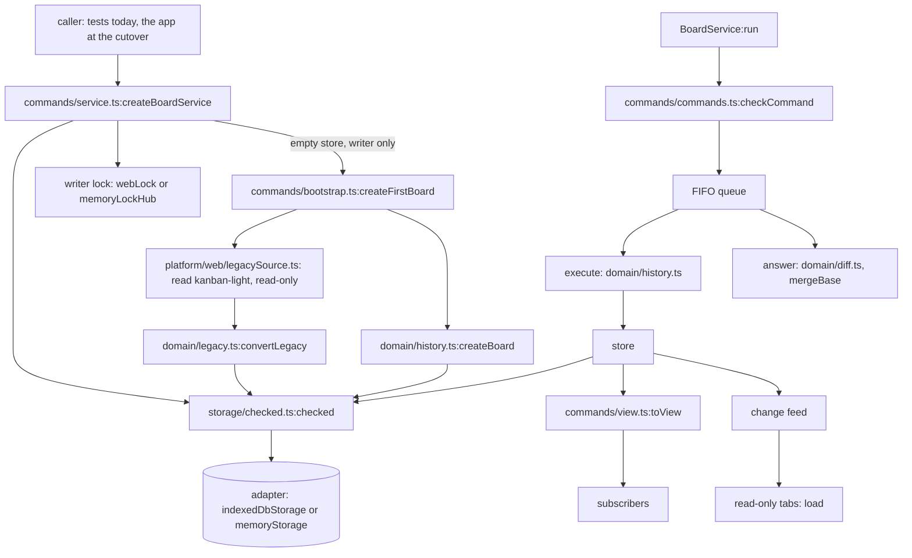

# Execution flow

How execution moves through KanbanLight 0.0.2. This describes the current code; it will be replaced at the Stage 3 cutover, when the app starts using the new data layer (last section). There are two programs. One is the browser app in `src/`. The other is the optional `kb` CLI in `cli/`, which talks to the app over a local WebSocket bridge.

## Entry points

| Entry | Started by | File |
|---|---|---|
| Browser app | `npm run dev` / `npm run build` (Vite), loads `index.html` | `index.html`, then `src/main.tsx` |
| CLI | `npx tsx src/index.ts <command>` from `cli/` (written `kb <command>` below; `kb` is not installed by any step) | `cli/src/index.ts` |
| CLI bridge server | `kb serve` (alias `kb start`), default port 8080 | `cli/src/server.ts:startCliServer` |

The app has no routes. It is a single page. There are no background jobs except the bridge reconnect timer (below), which runs only on a page served from `localhost` or `127.0.0.1`.

## Browser app: startup order

1. `index.html` loads `/src/main.tsx`.
2. Module evaluation creates singletons before React renders:
   - `src/services/BranchingService.ts:branchingService`. The constructor runs `loadBranches()`, which reads `localStorage['kanban-branches']`:
     - missing: creates and saves the `main` branch;
     - not JSON, or not `[id, {id, name}]` pairs with a text pointer (`readSavedBranches` returns `null`): sets `loadError`, keeps the list empty and never saves, so the stored value is kept;
     - pointer to a branch that is not listed: `keepUnknownPointer` adds it as a branch named `recovered` (or `recovered-2`, …) with parent `main`, and saves. A pointer to a missing `main` recreates `main` instead (`createMainBranch`).
   - `src/services/DatabaseService.ts:databaseService` (no I/O yet).
   - `src/services/CliSyncService.ts:cliSyncService` (port 8080, not connected yet).
   - `src/store/useKanbanStore.ts:useKanbanStore`, a hand-rolled Zustand-style store on `useSyncExternalStore`.
3. `src/main.tsx` renders `<App/>` inside `StrictMode` and `src/components/RecoveryScreen.tsx:RecoveryBoundary`. In dev mode, StrictMode runs effects twice. If any render below throws, the boundary replaces the page with `RecoveryScreen:RecoveryView`, which uses no store or provider. Its "Download data" button runs `RecoveryScreen:downloadData`: it reads every IndexedDB `kanban-light` object store read-only (opening with no version, and aborting the upgrade if no database exists so none is created) plus every `localStorage` key starting with `kanban`, and saves them as `kanbanlight-data-<date>.json`. Nothing is written or deleted.
4. `src/App.tsx:App` renders `RecoveryScreen:RecoveryView` instead of the board when `branchingService.loadError` is set, so the store never initialises over an unreadable branch list. Otherwise it renders `ThemeProvider`, then `KanbanBoard` and `CommandPalette`.
5. `src/components/KanbanBoard.tsx:KanbanBoard` runs `useEffect` → `useKanbanStore:initializeStore`:
   - `DatabaseService:initialize` opens IndexedDB `kanban-light` v2 and creates stores in `upgrade`.
   - `DatabaseService:getAllBoards`. If there is none, it creates `default-board` (`saveBoard`).
   - `DatabaseService:getCardsByBoard` and `getEventsByBoard`.
   - It builds the local user (`name: 'You'`).
   - `CliSyncService:connect` returns at once unless the page's hostname is `localhost` or `127.0.0.1`, so the hosted site never opens a socket. Otherwise it opens `ws://127.0.0.1:8080` and, on close, reconnects every 3 s (`scheduleReconnect`). `isCliConnected` is written only when it changes (`setConnected`).
   - `activeBranchId` comes from `BranchingService:getCurrentBranch`.
   - If the branch has no snapshot (`DatabaseService:getLatestSnapshotByBranch`), it calls `useKanbanStore:createSnapshot`.
6. `KanbanBoard` opens `GuidedTour` on first visit, when `localStorage['kanbanlight-tour-completed']` is not `'true'`.

## Browser app: main user actions

| Action | UI entry | Call chain |
|---|---|---|
| Add card (column) | `Column.tsx` add button | `useKanbanStore:createCard` → `DatabaseService:saveCard` → `useKanbanStore:dispatchBoardEvent` → `DatabaseService:saveEvent` |
| Add card (modal) | sidebar Quick Actions "New card" (or palette) → `SmartCardCreator.tsx` | `KanbanBoard:handleCreateCard` → `useKanbanStore:createCard` |
| Open / expand card | `Card.tsx:handleCardClick` (double-click opens, single click expands) | opens `CardDetailModal.tsx` |
| Edit / move / delete | `CardDetailModal.tsx` | `useKanbanStore:updateCard` / `deleteCard` → `DatabaseService:saveCard` / `deleteCard` → `dispatchBoardEvent` |
| Open Branch Manager | header button, sidebar "Manage Branches", or palette | `useKanbanStore:setShowBranchManager(true)` → `KanbanBoard` renders `BranchManager.tsx` |
| Create branch | `BranchManager.tsx:handleCreateBranch` | `BranchingService:createBranch` → `useKanbanStore:createSnapshot` → `useKanbanStore:switchBranch` |
| Switch branch | `BranchManager.tsx` switch button | `BranchingService:switchBranch` → `useKanbanStore:switchBranch` → `createSnapshot` (current) → `DatabaseService:getLatestSnapshotByBranch` (target) → `DatabaseService:syncActiveBoardCardsAndEvents` → `BranchingService:setActiveBranchId` |
| Compare | `BranchManager.tsx` compare button | `useKanbanStore:startBranchDiff`, which diffs the in-memory cards against the target's latest snapshot. `Column.tsx` reads `branchDiff` and renders `Card` with `diffStatus` |
| Exit compare | banner button in `KanbanBoard.tsx` | `useKanbanStore:exitDiffMode` |
| Export | header Database button in `KanbanBoard.tsx` | inline handler serializes the store's `events` array only (not cards, branches or snapshots) → Blob download `kanban-export-<ts>.json`. `DatabaseService:exportData` exists but nothing calls it |
| Command palette | Ctrl/Cmd+K (`CommandPalette.tsx`) | `setShowSmartCardCreator` / `setShowBranchManager` / other actions |
| Theme | header toggle | `ThemeProvider.tsx:toggleTheme` → `localStorage` |
| Branch names in the header badge and compare banner | `KanbanBoard.tsx:branchName` | `BranchingService:getBranches`, falling back to the id |

Storage split: branches and the active branch id live in `localStorage` (`BranchingService`). Cards, events, boards and per-branch snapshots live in IndexedDB (`DatabaseService`).

## CLI flow

1. `cli/src/index.ts` parses argv with `commander`. Usage errors exit 1 before anything is sent: extra arguments (`allowExcessArguments(false)`), a priority or column outside `.choices()`, an empty or blank title or branch name (`required`), and a `serve -p` value that is not a port from 1 to 65535 (`parsePort`).
2. `kb serve` → `cli/src/server.ts:startCliServer` → `CliBridgeServer:start`. This is a `ws` `WebSocketServer` bound to `127.0.0.1` with a 64 KiB `maxPayload`. Its `verifyClient` accepts a connection with no `Origin` (the CLI) or from `http://localhost` / `http://127.0.0.1` on ports 5173 and 4173, and refuses the rest. The banner is printed from the `listening` event; an `error` event (for example `EADDRINUSE`) prints "Couldn't start the bridge: …" and exits 1 (`failToStart`). Every message that is a JSON object is broadcast to all open clients and logged as `Relayed <type> to <n> clients`; anything else is dropped.
3. Every other command (`switch`/`checkout`, `add`, `branch [-b]`, `compare`/`diff`, `exit-diff`) → `cli/src/commands/index.ts:<command>` → `cli/src/services/BridgeClient.ts:sendToBridge`. That opens a socket to `ws://127.0.0.1:8080`, sends one JSON message and closes. If the bridge is down it returns `false` after a 1.2 s timeout, and the command sets `process.exitCode = 1` (so does an unexpected error). A success line only says the command was sent. `branch -b` sends one `CREATE_BRANCH` and nothing else.
4. The bridge broadcasts to the browser → `src/services/CliSyncService.ts:onmessage` → `src/services/bridgeProtocol.ts:parseBridgeFrame`, which checks the frame (size, JSON object, known type, no extra keys, field types and lengths, known column and priority). A rejected frame logs one `console.warn` with the reason (never the frame) and changes nothing. An accepted frame goes to `CliSyncService:handleCommand`:
   - `SWITCH_BRANCH` → `bridgeProtocol:resolveBranch` → `BranchingService:switchBranch`
   - `CREATE_BRANCH` → `BranchingService:createBranch` (then `switchBranch` if `checkout`)
   - `COMPARE_BRANCH` → `bridgeProtocol:resolveBranch` → `useKanbanStore:startBranchDiff`
   - `EXIT_DIFF` → `useKanbanStore:exitDiffMode`
   - `CREATE_CARD` → `useKanbanStore:createCard`
   - `HANDSHAKE_ACK` (the bridge's greeting) → ignored

`resolveBranch` takes the CLI's branch name or id: an exact id wins, otherwise the name must belong to exactly one branch. An unknown or shared name logs one `console.warn` and changes nothing.

## Data layer (built, not yet used by the app)

Stage 2 of the rebuild added a new data layer in `src/domain`, `src/storage`, `src/commands` and `src/platform`. Nothing above imports it, so it is on no execution path and the built app does not contain it. Its tests are its only callers until the Stage 3 cutover, which rewrites the rest of this file.

**Opening a board.** Whoever opens a board (the app at the cutover, a test today) calls `src/commands/service.ts:createBoardService` with a `Platform`: a storage adapter, a writer lock, a change feed, a clock, an id source and, on the web only, a 0.0.2 data source. The web versions are `src/platform/web/indexeddb.ts:indexedDbStorage` (database `kanbanlight`), `locks.ts:webLock` (Web Locks), `feed.ts:broadcastFeed` (BroadcastChannel) and `legacySource.ts:legacyWebSource`. Tests use `src/storage/memory.ts:memoryStorage` and `src/commands/ports.ts:memoryLockHub` / `memoryFeedHub`.

1. `createBoardService` wraps the adapter in `src/storage/checked.ts:checked`, which checks every record read and every change written, then calls the adapter's `open`.
2. It asks for the writer lock. The first instance (tab) gets it; any other is read-only and follows the writer through the change feed.
3. `load` reads the oldest board. On an empty store the writer calls `src/commands/bootstrap.ts:createFirstBoard`:
   - with no 0.0.2 data source, or a `migration` meta marker already stored: `src/domain/history.ts:createBoard` (board, `main`, root commit, empty working copy);
   - otherwise `legacyWebSource().read` reads IndexedDB `kanban-light` and the `kanban*` localStorage keys without writing (no data: a new board);
   - `src/domain/legacy.ts:convertLegacy` turns the 0.0.2 data into new records and a list of what it changed. An unreadable branch list gives a new board and a `failed` marker. Otherwise every converted change is checked (`checked.ts:checkChange`) and stored in one batch with the `migration` marker. A read or store that fails writes nothing and fails the open, so the next open tries again.
4. If opening fails, the lock is given back.
5. `src/commands/view.ts:toView` builds the first view.

**Running a command.** `BoardService:run(command)` → `src/commands/commands.ts:checkCommand` → one FIFO queue (`enqueue`). Queries (`board.view`, `branch.list`, `branch.compare`) go to `answer`, which reads the in-memory state. Compare also reads the other branch's working copy and any commits not yet loaded from storage, then calls `src/domain/history.ts:mergeBase` and `src/domain/diff.ts:compareBranches`. Commands go to `execute`, refused when read-only:

| Command | Domain call |
|---|---|
| `card.create`, `card.update`, `card.move`, `card.delete` | `history.ts:applyCardChange` |
| `branch.switch` | `names.ts:resolveBranch` → `history.ts:switchBranch` (commits a changed working copy first) |
| `branch.create` | `names.ts:resolveBranch` (for `from`) → `history.ts:createBranch` → `switchBranch`, in one batch |

Each domain call returns a batch of changes. `store` writes it with `checked(adapter).apply` (all or nothing). Only after the write succeeds does it update the in-memory state, rebuild the view (`toView`, which keeps every unchanged object), call subscribers if the view changed, and publish to the change feed. A failed command sets the view's `lastError`.

**Other tabs and "Use here".** A read-only instance's feed listener re-runs `load` through the queue. `BoardService:takeOver` steals the lock in one queued task and re-reads the board before acting as the writer. The old writer's `onLost` callback makes it read-only.

**Export.** `src/storage/exportFormat.ts:writeExport` reads through the adapter into the export file (format `kanbanlight`, version 1). `readExport` checks a file and returns its records and warnings. No UI calls either yet.

